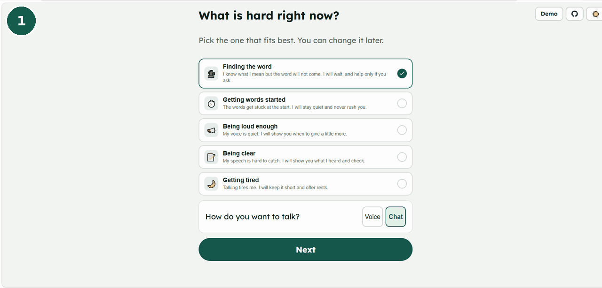
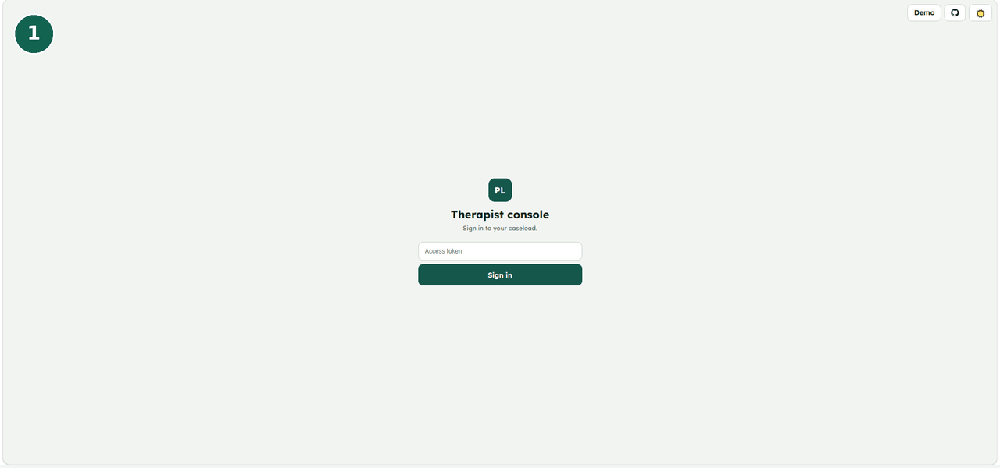
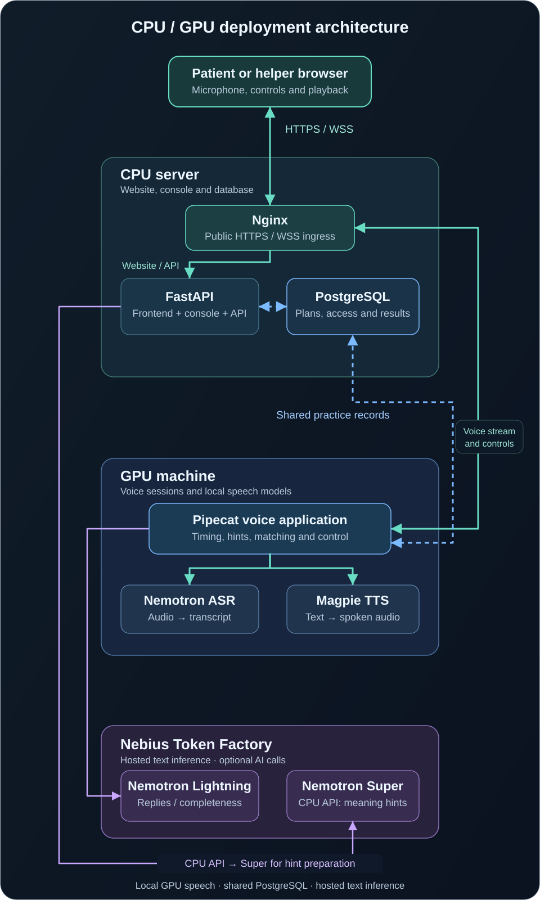

# Patient Listener

**A voice practice partner that gives people time to speak.**

[](LICENSE)
[](pyproject.toml)
[](https://tokenfactory.nebius.com/)

Patient Listener helps adults practise personally meaningful words and phrases at their own pace. It waits during pauses, offers hints when requested, shows speech transcripts, and lets a therapist or carer manage the practice material.

NVIDIA Nemotron and Magpie provide speech recognition, short AI replies and spoken hints. **The Python controller decides when to speak, how to respond to an attempt and when to stop. A model does not approve words or interpret a person's health.**

Built for the Nebius × NVIDIA Global AI Hackathon. This is a practice partner, not a diagnostic tool or a replacement for professional care.

[Try the app](#try-the-deployed-app) · [Demo Previews](#demo-previews) · [Use Cases](#use-cases) · [How it works](#how-it-works) · [Model stack](#powered-by-nebius-token-factory-and-nvidia) · [Quick start](#quick-start-without-a-gpu) · [Deployment](#reproducing-the-deployment) · [Documentation](#documentation) · [Compliance](COMPLIANCE.md) · [Feedback](FEEDBACK.md)

## Demo Previews

**[Watch the public demo video on YouTube](https://youtu.be/rpJwb4DllFM)**

### Patient practice



### Therapist console



## Why it exists

A pause is not an invitation to interrupt. Speech practice should give a person time to find a word, get it started, speak more clearly or take a rest.

Patient Listener combines patient-controlled pacing with a human-approved word list. The goal is a predictable practice experience: one current target, help when requested, a clear Stop action, and progress records that describe practice rather than making medical judgments.

## Try the deployed app

Patient Listener is deployed with the frontend/API, PostgreSQL and Nginx on a Linux CPU server, and the voice application and NVIDIA models on a separate GPU machine.

| Entry point | Address |
| --- | --- |
| Patient website | https://patientlistener.magnusmage.com/ |
| Live voice practice | https://patientlistener.magnusmage.com/?voice=1 |
| Therapist/carer console | https://patientlistener.magnusmage.com/console.html |
| Voice WebSocket endpoint | `wss://voice.patientlistener.magnusmage.com/ws` |

Use the permanent HTTPS links above. Live practice requires microphone permission and an enrolled browser/device.

### Demo console access

Open the [therapist/carer console](https://patientlistener.magnusmage.com/console.html) and paste the token for the role you want to test.

**Therapist access token:**

```text
plconsole_p_GfG_ZsAgGo3lgw-XWGGWEnf6j2RrByu3sFI5wEPjQ
```

**Carer access token:**

```text
plconsole_xI-Aqne8Y1tA5DrLgJNRD7XY1XU15ccUNH_IfIrq9K8
```

These demo access tokens are intentionally public and grant the relevant helper permissions for their linked patients; they are not read-only credentials. Use fictional demo data only. They are console credentials, not Nebius API keys or patient device setup codes.

### A short test session

1. Open the therapist console and sign in with the therapist demo token above.
2. Select a linked patient and open their caseload.
3. Open **Devices** and generate a device setup code.
4. Open the patient demo in the browser/device being enrolled, enter the code and allow microphone access.
5. Start practice, speak a response, request a hint, try rest/resume and finish the session.
6. Check the recorded practice in the console.

Setup codes are single-use and expire after ten minutes. Each browser/device needs its own enrollment. A fresh database seeds **Margaret**, **Daniyal** and **Joseph**; additional development personas and history are not bundled database files.

No GPU is needed to explore the browser-only replay or local text-driven backend described below.

## What the app does

| Capability | Behavior |
| --- | --- |
| Patient-paced conversation | Profile-specific waits, half-duplex playback, typed controls, Stop and session limits |
| Word-finding practice | One target at a time; meaning, sound and word hints; deterministic matching and confirmation |
| Getting words started | A quiet profile that avoids filling speech blocks with hints or backchannels |
| Being loud enough | Five-phrase calibration and relative loudness feedback from microphone audio |
| Being clear | Transcription feedback with confirmation before recording a successful attempt |
| Saving energy | Turn limits, rest offers and resume handling |
| Therapist/carer console | Linked caseload, draft words, approval permissions, cue editing, settings and progress |
| Prepared practice | Approved-word selection, FSRS scheduling, generated hints and cached spoken clips |
| Enrolled device access | Helper-issued setup codes, device-bound short-lived session tokens and revocation |
| Data controls | Explicit consent records, person-requested export and confirmed deletion flows |
| AI-off mode | Template replies and hints; local GPU speech can continue without Token Factory calls |

These are implementation capabilities, not clinical effectiveness claims or a claim that every deployment acceptance gate has passed.

## Use Cases

- **Finding a word:** practise a personally meaningful word, with meaning, first-sound and full-word hints available when requested.
- **Getting words started:** speak about an open topic while the app leaves space for pauses and avoids interrupting speech blocks.
- **Being loud enough:** complete microphone calibration, then practise phrases with relative loudness feedback.
- **Being clear:** review what the speech recognizer heard and confirm an attempt before it is recorded as successful.
- **Saving energy:** practise in short turns, take a rest and resume when ready, or stop the session.
- **Supporting practice:** a linked carer adds draft words and meaning cues; a therapist reviews material, adjusts settings and checks recorded practice.

## How it works

### One session

1. **Prepare:** a therapist or authorized carer adds words and cues; drafts need the appropriate human approval.
2. **Build a plan:** code selects approved practice material. Templates provide hints by default; an explicit AI option asks Nemotron Super for a constrained meaning hint. Magpie prepares the audio.
3. **Authorize:** the API checks the enrolled browser and issues a short-lived signed token for voice.
4. **Listen:** the browser streams microphone audio to the GPU. NeMo produces speech events and transcripts for the controller.
5. **Respond:** code applies timing, target matching, hint progression and safety rules. Optional Lightning wording is validated and falls back to templates when unavailable, late or rejected.
6. **Record:** structured attempts and FSRS updates are stored in the shared database. Prepared audio is synthesized material, not a patient recording.

### CPU/GPU deployment architecture



Nginx, the frontend/API and PostgreSQL run on the CPU server. The GPU runs the voice application and models. Both public domains point to the CPU server: website requests reach the API, while voice requests are proxied to the GPU. Both application services use the same PostgreSQL database, matching signing/service secrets and the same audio settings.

The browser obtains its short-lived voice token from the website API, then connects to the voice domain. The API also calls the voice domain's authenticated `/internal/render` route when preparing spoken hints. Nginx terminates public HTTPS/WSS; GPU model files and caches remain on the GPU and are not part of the CPU image.

## Powered by Nebius Token Factory and NVIDIA

| Role | Model | Runs where |
| --- | --- | --- |
| Live speech recognition | `nvidia/nemotron-speech-streaming-en-0.6b` | Local NVIDIA GPU through NeMo |
| Spoken prompts, replies and prepared hints | `nvidia/magpie_tts_multilingual_357m` | Local NVIDIA GPU through NeMo |
| Short replies and profile-specific completeness checks | `nvidia/Nemotron-3_5-Lightning` | Nebius Token Factory |
| AI-assisted meaning hints during plan generation | `nvidia/nemotron-3-super-120b-a12b` | Nebius Token Factory |

Token Factory calls use the OpenAI-compatible endpoint:

```text
POST https://api.tokenfactory.nebius.com/v1/chat/completions
```

See [the adapter](src/patient_listener/llm/token_factory.py), [model configuration](src/patient_listener/config.py) and [reply validation](src/patient_listener/llm/validate.py). The API key stays on the server. Token Factory is used for LLM inference; ASR and TTS run on the separate GPU, not on Token Factory or an assumed Nebius GPU deployment.

The controller owns timing and outcome decisions. Model output is constrained and validated, but output validation is not proof of semantic correctness. The live reply path uses a strict deadline and template fallback; provider latency can therefore yield a template even when an independent model smoke test succeeds.

### Controlling model spend

With a persistent store, `AI_ENABLED` initializes a saved switch; editing the environment does not override an existing saved value. Use the switch CLI against the selected database:

```bash
# Select the real private configuration; omit --db for PostgreSQL.
PL_ENV_FILE=/absolute/path/to/private.env \
python -m patient_listener.tools.switch --ai-enabled false --reason "Template-only demo"
```

`MAX_LIGHTNING_CALLS` caps live model attempts per session. Plan generation makes no Super calls unless `use_ai`/`--use-ai` is explicitly requested and the saved AI switch permits it.

## Quick start without a GPU

Requires **Python 3.12**. From a fresh checkout, the following starts a local, text-driven development server with a persistent SQLite database and AI off:

```bash
git clone https://github.com/magnusmage/patient-listener.git
cd patient-listener
python3 -m venv .venv
source .venv/bin/activate
python -m pip install -e ".[api]"

AI_ENABLED=false VOICE_ENABLED=false PL_ENV=development \
PL_SERVICE_ROLE=combined REQUIRE_HTTPS=false \
DATABASE_URL=sqlite:///./pl.db \
python -m patient_listener.app
```

On Windows, create the environment with `python -m venv .venv`, use `.venv\Scripts\python.exe`, and set the same environment variables with PowerShell's `$env:NAME="value"` syntax. Activation is optional when using the environment's Python executable directly.

Open **http://127.0.0.1:8000/** for the Python-controlled text mode. This is not a microphone session. A fresh checkout uses development defaults; existing exported variables or a private `.env` can change behavior. Configuration loads from the selected `PL_ENV_FILE`, otherwise the working-directory `.env`, with exported values taking precedence.

In a second terminal using the same environment and repository folder, provision local console access:

```bash
python -m patient_listener.tools.console_access --db pl.db grant \
  --user sam --name Sam --role therapist --hours 48 \
  --person demo-margaret --person demo-daniyal --person demo-joseph
```

Open **http://127.0.0.1:8000/console.html** and use the printed token. A carer uses `--role carer` with only their linked patients. Re-granting an identity replaces its old tokens. Sign-out clears the console session; it does not revoke the underlying token. Expiry, administrative revocation and replacement are separate.

For an integrated CPU-only plan test, keep that server running and use:

```bash
python -m patient_listener.tools.generate_plan --person margaret --max-words 1 --text-only
```

Enter the linked console token, not the Nebius key. `--text-only` skips GPU audio generation. Do not omit it in a CPU-only setup.

### Browser-only replay

Open `web/demo.html` directly, or serve the static files:

```bash
python -m http.server 8080 --directory web
```

Open **http://127.0.0.1:8080/?demo=1**. This exercises a browser simulation with demo controls; it does not use Python session logic, a microphone or NVIDIA inference. It is useful for UI exploration, not live-model evidence.

## Live GPU voice

The tested development machine is Ubuntu 24.04, Python 3.12, an RTX 5070 with 12 GB VRAM, PyTorch 2.9.1+cu128, NeMo 3.0 and Pipecat 1.12.0. This is an observed working setup, not a universal minimum specification.

Use the [GPU container guide](docs/GPU_CONTAINER.md), [browser voice guide](docs/GPU_BROWSER_VOICE.md) and [Pipecat acceptance notes](docs/PIPECAT_ACCEPTANCE.md) for prerequisites and validation. Do not install the entire voice stack over an existing working environment just to update application code. GPU weights and private model caches are not committed.

Both split roles need a persistent shared database, stable matching secrets and explicit enrollment. On a same-host rehearsal, after the environment, models and private config are ready:

```bash
# CPU/API role, in its own terminal
python -m patient_listener.tools.services run api --env-file .env.split

# GPU role, in another terminal using the same database and shared secrets
python -m patient_listener.tools.services run voice --env-file .env.split
```

These launch commands do not install models or create a complete production deployment. The voice container launcher additionally supports `PL_VOICE_ENV_FILE` for selecting an existing alternate config. Use one voice worker on the tested GPU.

`/?voice=1` requests the live microphone path. The API supplies its configured voice URL and a signed device-bound token; no API key is embedded in browser code. HTTPS/WSS and microphone permission are required for remotely hosted voice.

Generate spoken hints before testing playback:

```bash
python -m patient_listener.tools.generate_plan --person margaret --max-words 1
```

This uses templates and GPU TTS by default. It intentionally changes the saved plan and requires an authorized helper token. Prepared clips are keyed to text, voice, model and processing settings. Missing/stale prepared hints can display text without spoken playback; regenerate the plan after relevant changes. Stop active practice before generation.

## Reproducing the deployment

1. Build the CPU image from the full repository with `Dockerfile.api`.
2. Create PostgreSQL with persistent storage; run migrations before API startup.
3. Configure the CPU API role explicitly: `PL_SERVICE_ROLE=api`, `VOICE_ENABLED=false`.
4. Configure the GPU voice role and the same server database, two matching distinct shared secrets, and matching audio settings. Remove `PL_DB_PATH` for PostgreSQL.
5. Configure CPU Nginx for the website and voice domains, trusted certificates/renewal, a protected CPU-to-GPU route, and supervised service restarts.
6. Issue helper tokens, enroll browsers on the deployed website, generate a plan and verify a saved voice attempt.

The deployed API configuration uses:

```dotenv
PL_ENV=production
PL_SERVICE_ROLE=api
VOICE_ENABLED=false
NIGHTLY_ENABLED=false
REQUIRE_HTTPS=true
PATIENT_ENROLLMENT_REQUIRED=true
SESSION_TOKEN_TTL_S=900
VOICE_PUBLIC_WS_URL=wss://voice.patientlistener.magnusmage.com/ws
VOICE_INTERNAL_URL=https://voice.patientlistener.magnusmage.com
VOICE_ALLOWED_ORIGINS=https://patientlistener.magnusmage.com
```

Also provide the real `DATABASE_URL`, `SESSION_TOKEN_SECRET`, `VOICE_SERVICE_SECRET` and optional Token Factory key privately. Enable proxy trust only behind a restricted ingress that overwrites forwarded scheme headers. The API image defaults to `combined`; production must explicitly override that role. Health endpoints are `/livez` and `/healthz`; `text_ready`/`voice_ready` do not themselves prove end-to-end production acceptance.

The [PostgreSQL runbook](docs/POSTGRES_DEPLOYMENT_RUNBOOK.md) includes the fresh database helper, migration, backup and isolated restoration commands. Existing databases have explicit transfer instructions; a fresh install seeds the three built-in personas and does not require a SQLite import. Remote GPU database access needs its own secure network/TLS configuration.

Environment format matters: Docker `--env-file` and the application's dotenv loader do not have identical quoting behavior. Follow the launch method's format; never blindly inject the JSON-quoted generated development file into Docker. Shared signing/service secrets must not be regenerated independently on the two machines.

## Verification and known limits

| Checkpoint | Evidence/status |
| --- | --- |
| Browser voice | Exercised on the development GPU with transcription, spoken output and session controls |
| Shared PostgreSQL | Local API/voice rehearsal completed; practice records were written to PostgreSQL |
| Database recovery | Backup restored to an isolated database; people/word/attempt counts and revision `0005` checked |
| Token Factory | Small model and reply-pipeline smoke tests completed; not a latency benchmark or the full G-03 evidence set |
| Offline regression checks | Python unit tests and synthetic controller/release-gate checks are available in `tests/` |
| Hosted deployment | Permanent website and voice domains; CPU Nginx/API/PostgreSQL with a separate GPU voice service |

The project does not equate a synthetic gate, successful health response or one model call with clinical validation, representative speech accuracy or production readiness. The full G-03 model sample set, regional latency, naturalness and load/failure acceptance remain separate checks.

Other current boundaries:

- Access uses provisioned tokens and helper-assisted device enrollment; full passkey/MFA onboarding is not implemented.
- Development nightly scheduling and scoped agent tools exist, but the standard split launcher disables nightly work. Managed production nightly jobs, the Hermes/OpenShell agent and Telegram delivery are future work for this deployment.
- Core safety phrase handling is rule-based; it is not an emergency service or a guarantee of detecting a medical event.
- Privacy/consent APIs do not by themselves establish complete privacy or regulatory compliance. Review the documented boundaries before using real patient data.

### Running checks

The main runner uses stdlib `unittest` and synthetic/mocked adapters. Full discovery needs the API, store, LLM, Pipecat and audio-processing test dependencies; the core-only install is not enough for every test module. Dependency details and compatibility decisions are in [docs/DEPENDENCIES.md](docs/DEPENDENCIES.md).

```bash
python -m pip install -e ".[api,store,llm,pipeline]"
python -m pip install "numpy~=2.5" "soundfile~=0.13.1" "pyloudnorm==0.2.0" "audiotsm==0.1.2"
python run_tests.py
```

The runner reports its actual result; this README does not hardcode a changing test count. PostgreSQL integration checks are opt-in and must use their dedicated disposable local test database, never a demo or production database.

For the offline controller walkthrough:

```bash
python scripts/demo.py
```

An optional **paid** smoke test uses small explicit limits:

```bash
python -m patient_listener.tools.token_factory_check --runs 1 --pipeline-runs 1
```

It can make validation retries and needs the private Token Factory key. Do not run the default larger diagnostic just to check installation. Reports are not automatically public benchmark evidence.

## Documentation

Some notes are dated implementation snapshots; use the current code and newer acceptance notes when an earlier document describes work that has since changed.

| Guide | Purpose |
| --- | --- |
| [Compliance and evidence](COMPLIANCE.md) | Submission checklist, workbook traceability and release evidence |
| [Platform feedback](FEEDBACK.md) | Token Factory/NVIDIA observations and requested improvements |
| [Frontend handoff](docs/FRONTEND_HANDOFF.md) | API/voice contracts for frontend integration |
| [Service split](docs/SERVICE_SPLIT.md) | API/voice roles, shared database and admission contracts |
| [PostgreSQL deployment](docs/POSTGRES_DEPLOYMENT_RUNBOOK.md) | Database setup, migrations, backups and restoration |
| [Device enrollment](docs/PATIENT_DEVICE_ENROLLMENT.md) | Setup codes, cookies, device binding and revocation |
| [On-demand plans](docs/ON_DEMAND_PLANS.md) | Manual preparation and explicit AI opt-in |
| [Prepared audio](docs/PREPARED_AUDIO_ACCEPTANCE.md) | Cached clips, pacing, normalization and playback checks |
| [FSRS scheduling](docs/FSRS_ACCEPTANCE.md) | Real review updates and due-word selection |
| [Matching and pronunciation](docs/MATCHING_PRONUNCIATION_ACCEPTANCE.md) | Target matching and pronunciation assets |
| [Being heard](docs/BEING_HEARD_ACCEPTANCE.md) / [Being clear](docs/BEING_CLEAR_CONFIRMATION.md) | Calibration and confirmation behavior |
| [Consent](docs/CONSENT_API.md) / [Privacy](docs/PRIVACY_API.md) | Choices, export, deletion and retention boundaries |
| [Dependency compatibility](docs/DEPENDENCIES.md) | Pins and known platform/library constraints |

## Repository layout

```text
src/patient_listener/
  app/        FastAPI, session orchestration, enrollment, console and voice transport
  voice/      Controller, profiles, matching, hints, loudness and audio processing
  llm/        Token Factory adapters, constrained generation, validation and templates
  schedule/   FSRS review scheduling
  store/      SQLite/PostgreSQL adapters, migrations and data transfer
  tools/      Access provisioning, plans, diagnostics and database administration
web/          Patient app and helper console: HTML, CSS, JavaScript and AudioWorklet
scripts/      Offline walkthrough, pronunciation setup and deployment helpers
deploy/       Container support and PostgreSQL deployment configuration
Dockerfile.api    CPU frontend/API image
Dockerfile.voice  GPU voice image
run_tests.py      Offline suite runner and synthetic gate summary
tests/            Unit, integration and opt-in deployment checks
```

## Built with

**Nebius Token Factory**, **NVIDIA NeMo / Nemotron / Magpie**, **Pipecat**, **FastAPI**, **PostgreSQL / SQLite**, **SQLAlchemy / asyncpg / Alembic**, **FSRS**, **RapidFuzz / Jellyfish**, **NLTK / Epitran**, and plain browser HTML/CSS/JavaScript.

## License

[MIT](LICENSE) for the application source. Models and third-party libraries have their own terms; see [NOTICE](NOTICE) and the relevant model cards. No real patient dataset, private credentials, database dumps or GPU model weights are included in this repository.
